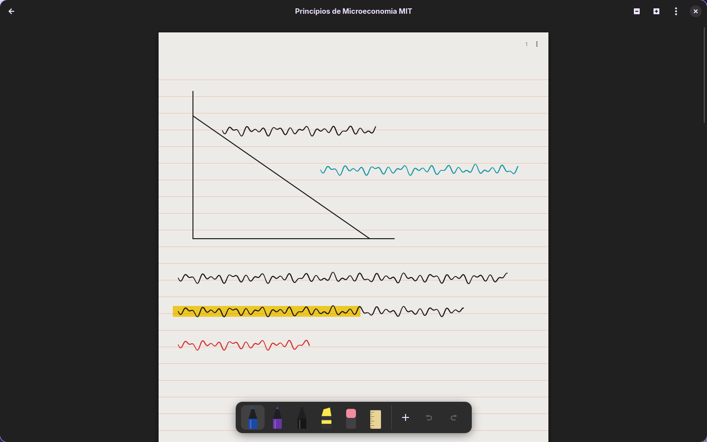

# Caderno

A handwriting notebook for Linux pen tablets, in the spirit of **Microsoft Journal**:
folders and notebooks on the home screen, and inside a notebook just paper, a pen and a
small floating toolbar. GTK4 + libadwaita, written in Python with Cairo. The UI is in
Brazilian Portuguese.




## Features

- **Home:** folders and notebooks as cards. Rename, recolor, move to another folder, send to the trash, search by name.
- **Notebook:** pages one after another, ruled, grid, dotted or plain. Writing on the last page adds a fresh one,
  and a full-width **Nova folha** button sits under the last page.
- **Six customizable tools.** Click the selected tool again to change its color and width:
  - three pressure-sensitive pens
  - a highlighter that stays underneath the ink
  - a stroke eraser
  - a ruler that draws a straight line in the last pen's color and snaps to 15° steps
- **Scratch out:** scribble back and forth over a word and it's erased, the way Journal does it. The
  scribble has to mostly cover the word, so ordinary writing next to it is never touched, and Ctrl+Z brings the word back.
- **Images:** paste with Ctrl+V, drop a file on a page, or use `+` → image from file. Move and resize them with the
  **mouse** (drag the bottom-right corner to resize), and Delete removes them. The pen always writes, including over images.
- **Pen and tablet buttons:**
  - The pen's lower barrel button scrolls the page: hold it and move the pen.
  - The upper button undoes.
  - The two rightmost tablet buttons (ExpressKeys) zoom out and zoom in.
  - The eraser end of a pen erases.
- **Keyboard:**
  - Ctrl+Z / Ctrl+Shift+Z undo and redo.
  - Ctrl+wheel, Ctrl+= and Ctrl+- zoom, Ctrl+0 fits the page.
  - Keys 1–6 pick a tool.
- **Export to PDF** (vector) from the notebook menu. Everything saves automatically.

## Storage

Notebooks live in `~/Documents/Cadernos` (your XDG documents folder). Set `CADERNO_DIR` to use another place.

- Folders are plain folders on disk.
- Each notebook is a `Name.caderno/` folder with a small `caderno.json` (strokes as point lists) and an `imagens/`
  folder, so backups and sync tools just work.

## Install

Requirements are GTK 4, libadwaita 1.4+ and PyGObject. On Arch:

```bash
sudo pacman -S gtk4 libadwaita python-gobject
git clone https://github.com/ludoviciphilip/caderno.git
cd caderno
./instalar.sh
```

`instalar.sh` installs for the current user only, with no root needed:

- a virtualenv with `pycairo` in `~/.local/share/caderno/venv`
- the `caderno` command in `~/.local/bin`
- a desktop entry and an icon

Run it again after `git pull` to update. If you have `python-cairo` installed system-wide, you can also run the app
directly with `python -m caderno`.

### Tips for Hyprland

```lua
-- tablet only on one monitor (adjust the name and the active area to your tablet)
hl.config({ input = { tablet = { output = "HDMI-A-1" } } })
-- open Caderno on that monitor, opaque
hl.window_rule({ match = { class = "io.github.ludoviciphilip.Caderno" }, monitor = "HDMI-A-1",
                 opaque = true, no_blur = true })
```

## Status

Young and personal, but usable daily. Ideas for later:

- import PDFs as pages to annotate
- page thumbnails in a sidebar
- lasso selection to move handwriting
- a partial eraser

Issues and pull requests are welcome.

## License

MIT
