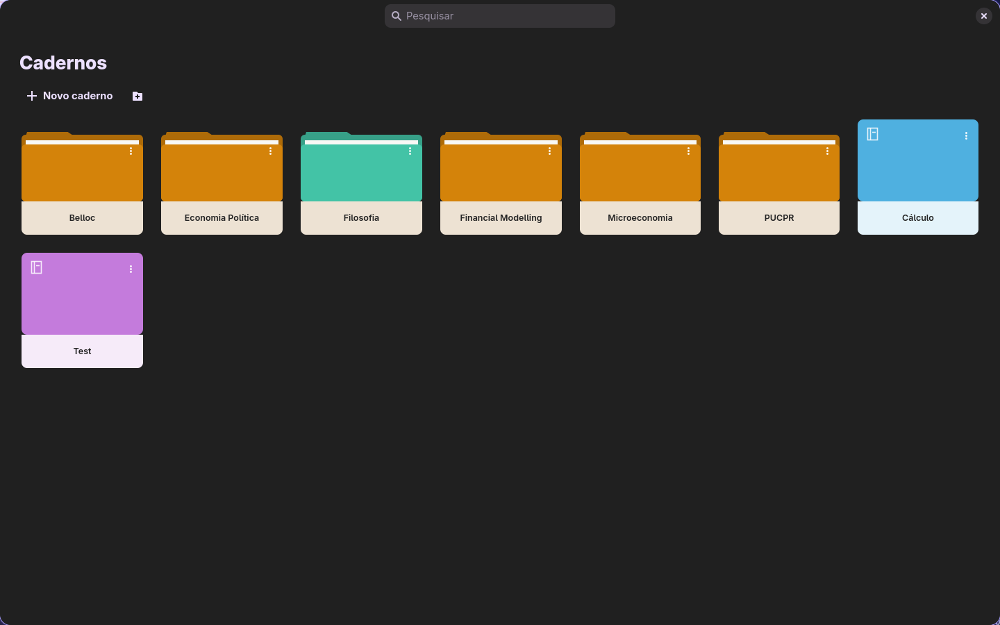

# Caderno

**Open-source handwriting notebook for Linux pen tablets** — a [Microsoft Journal](https://en.wikipedia.org/wiki/Microsoft_Journal)
/ [OneNote](https://www.onenote.com/) alternative, in the spirit of Xournal++: folders and notebooks on the home
screen, and inside a notebook just paper, a pen and a small floating toolbar. Pressure-sensitive strokes with
[Wacom](https://www.wacom.com/), [XP-Pen](https://www.xp-pen.com/) and other Linux-supported tablets. Built with
GTK4 and libadwaita for GNOME, written in Python with Cairo. The interface is in English, Portuguese and Spanish.

*Microsoft Journal, OneNote and Wacom are trademarks of their respective owners; Caderno is not affiliated with
or endorsed by Microsoft or Wacom.*

[](LICENSE)
[](https://www.gtk.org/)
[](https://gnome.pages.gitlab.gnome.org/libadwaita/)
[](#install)

**[Features](#features) · [Install](#install) · [Usage](#language) · [Storage](#storage)**




## Why Caderno

Most Linux note-taking apps for pen tablets are either general-purpose PDF annotators (Xournal++) or heavyweight
cross-platform suites. Caderno focuses on one thing: a fast, distraction-free digital notebook that feels like
writing on paper, inspired by the now Windows-only Microsoft Journal, built natively for GNOME with GTK4 and
libadwaita.

## Features

- **Home:** folders and notebooks as cards. Rename, recolor, move to another folder, send to the trash, search by name.
- **Notebook:** pages one after another, ruled, grid, dotted or plain. Writing on the last page adds a fresh one,
  and a full-width **Nova folha** button sits under the last page.
- **Six customizable tools.** Click the selected tool again to change its color and width:
  - three pressure-sensitive pens
  - a highlighter that stays underneath the ink
  - a stroke eraser
  - a ruler that draws a straight line in the last pen's color and snaps to 15° steps
- **Smart shapes:** draw a line, circle, ellipse, rectangle or triangle and keep the pen still on the page for
  a moment. The rough stroke turns into a clean shape: lines snap to 0°/45°/90°, near-round ellipses become circles,
  near-square rectangles become squares. You can turn this off in the home screen menu.
- **Headings:** draw a `#` at the start of a line and keep the pen still for a moment. It turns into a purple
  heading marker, and whatever you write on that line is the heading. Erase the marker to undo it.
- **Index:** the list button at the top left opens a sidebar with every heading and smart shape in the notebook,
  page by page, with a thumbnail. Click one to jump to it.
- **Pressure response:** in the ⋮ menu, choose how the line responds to the pen. *Follows pressure* is the default.
  *Gentle pressure* keeps a little variation but steadies the line when you write with the pen tilted (tablets
  read less pressure then). *Uniform* ignores pressure. It applies to new strokes only.
- **Scratch out:** scribble back and forth over a word and it's erased, the way Journal does it. The
  scribble has to mostly cover the word, so ordinary writing next to it is never touched, and Ctrl+Z brings the word back.
- **Images:** paste with Ctrl+V, drop a file on a page, or use `+` → image from file. Move and resize them with the
  **mouse** (drag the bottom-right corner to resize), and Delete removes them. The pen always writes, including over images.
- **Pen and tablet buttons:**
  - The pen's lower barrel button scrolls the page: hold it and move the pen.
  - The upper button undoes.
  - The two rightmost tablet buttons (ExpressKeys) zoom out and zoom in.
  - The eraser end of a pen erases.
- **Keyboard:**
  - Ctrl+Z / Ctrl+Shift+Z undo and redo.
  - Ctrl+wheel, Ctrl+= and Ctrl+- zoom, Ctrl+0 fits the page.
  - Keys 1–6 pick a tool.
- **Export to PDF** (vector) from the notebook menu. Everything saves automatically.

## Install

Requirements are GTK 4, libadwaita 1.4+ and PyGObject. On Arch:

```bash
sudo pacman -S gtk4 libadwaita python-gobject
git clone https://github.com/ludoviciphilip/caderno.git
cd caderno
./instalar.sh
```

`instalar.sh` installs for the current user only, with no root needed:

- a virtualenv with `pycairo` in `~/.local/share/caderno/venv`
- the `caderno` command in `~/.local/bin`
- a desktop entry and an icon

Run it again after `git pull` to update. If you have `python-cairo` installed system-wide, you can also run the app
directly with `python -m caderno`.

Caderno currently ships from source only (no Flatpak or AUR package yet); the install script above is the supported
path on any distro with GTK4 and libadwaita 1.4+, including Arch, Fedora and recent Ubuntu/Debian.

### Tips for Hyprland

```lua
-- tablet only on one monitor (adjust the name and the active area to your tablet)
hl.config({ input = { tablet = { output = "HDMI-A-1" } } })
-- open Caderno on that monitor, opaque
hl.window_rule({ match = { class = "io.github.ludoviciphilip.Caderno" }, monitor = "HDMI-A-1",
                 opaque = true, no_blur = true })
```

## Language

The home screen menu (⋮) switches between English, Português and Español, or **Automatic**, which follows the
system locale. The choice is saved in `~/.config/caderno/config.json`; `CADERNO_LANG=en|pt|es` overrides it for a
single run.

## Storage

Notebooks live in `~/Documents/Cadernos` (your XDG documents folder). Set `CADERNO_DIR` to use another place.

- Folders are plain folders on disk.
- Each notebook is a `Name.caderno/` folder with a small `caderno.json` (strokes as point lists) and an `imagens/`
  folder, so backups and sync tools just work.

## Alternatives

If you're comparing Linux pen-tablet note apps:

- **[Xournal++](https://xournalpp.github.io/)** — mature, feature-rich PDF annotator and notebook app; a good fit
  if you need PDF annotation, LaTeX and plugin support. Caderno is simpler and focused on a Journal-like
  folders-then-paper flow.
- **Microsoft Journal / OneNote** — Windows-only (and cloud-first for OneNote); Caderno is a native Linux
  alternative with local-only storage.

## Status

Young and personal, but usable daily. Ideas for later:

- import PDFs as pages to annotate
- page thumbnails in a sidebar
- lasso selection to move handwriting
- a partial eraser

Issues and pull requests are welcome — see [CONTRIBUTING.md](CONTRIBUTING.md).

## License

MIT
